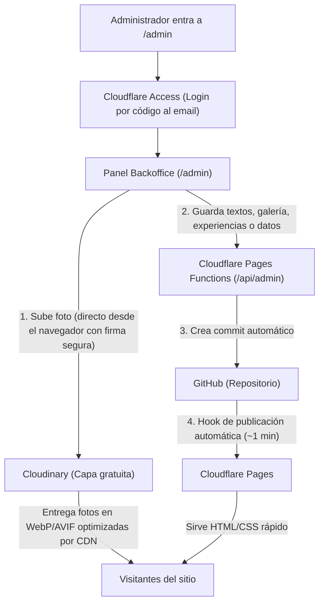

# Guía del Panel Administrativo (Backoffice) · Río Téllez

El panel administrativo (`/admin`) permite gestionar la landing page sin necesidad de tocar código ni tener cuentas de GitHub para los administradores o editores.

---

## 1. ¿Cómo funciona la arquitectura?



### Características implementadas:
1. **Galería de fotos:**
   - Subida directa a Cloudinary (hasta 10 MB por archivo en plan gratuito, con ajuste automático si se excede).
   - Conversión y entrega automática en **WebP o AVIF** mediante CDN (`f_auto,q_auto`), sin pérdida de calidad visible y con carga ultrarrápida.
   - Organización por categorías (`rio`, `cafe`, `senderos`, `gastronomia`, `familias`).
   - Títulos, descripciones y textos alternativos bilingües (**Español e Inglés**).
   - Marcación de **Portada** (para mostrar en la home, máx. 6) y **Destacada** (tamaño doble en la página de galería).
   - Reordenamiento visual con botones de mover (arriba, adelante, atrás).
   - Compatibilidad híbrida: conviven fotos que ya estaban en el repositorio con las nuevas que se suban a la nube.
   - Al borrar una foto de la nube desde el panel, se limpia automáticamente de Cloudinary para no ocupar espacio.
2. **Experiencias turísticas:**
   - Edición de títulos, descripciones, duración, precios individuales en COP, categorías, color de etiqueta y lista de elementos que incluye.
   - Posibilidad de cambiar la foto por una nueva de Cloudinary.
   - Creación de nuevas experiencias y eliminación de existentes.
3. **Datos generales del sitio:**
   - Número de WhatsApp (con indicativo).
   - Precios base (por persona y por bolsa de café).
   - Horarios de salida (24 h).
   - Mínimo y máximo de viajeros.
   - Redes sociales (Facebook, TikTok, Instagram).
   - Datos de la cooperativa (NIT, razón social, altura msnm, dirección, coordenadas del mapa).
4. **Seguridad y privacidad:**
   - `/admin` está excluido del sitemap y bloqueado para motores de búsqueda en `robots.txt`.
   - La API `/api/admin/*` verifica la firma criptográfica JWT de Cloudflare Access.
   - Las llaves secretas de Cloudinary y GitHub nunca se exponen al navegador.

---

## 2. Pasos para configurarlo (100% gratuito)

### Paso A: Cuenta de Cloudinary (para guardar y servir las fotos)
1. Regístrese gratis en [cloudinary.com](https://cloudinary.com).
2. En el Dashboard principal obtendrá:
   - **Cloud name** (ejemplo: `rio-tellez-coop`)
   - **API Key** (ejemplo: `123456789012345`)
   - **API Secret** (ejemplo: `abcdefghijklmnopqrstuvwxyz`)
3. ¡Listo! Cloudinary ofrece 25 créditos mensuales gratuitos (suficiente para miles de visitas al mes y decenas de gigabytes de transferencia).

---

### Paso B: Token de GitHub (para que el panel guarde los cambios)
1. Vaya a [github.com/settings/tokens?type=beta](https://github.com/settings/tokens?type=beta) (Fine-grained tokens).
2. Haga clic en **Generate new token**:
   - **Token name:** `Rio Tellez Cloudflare Admin`
   - **Expiration:** Seleccione la duración deseada (o 1 año).
   - **Repository access:** Seleccione *Only select repositories* y elija `ovelasqueza/rio-tellez-website`.
   - **Permissions → Repository permissions:**
     - **Contents:** Marque `Read and write`.
3. Genere el token y cópielo (empieza por `github_pat_...`).

---

### Paso C: Cloudflare Access / Zero Trust (Login con código al correo, sin contraseñas)
Cloudflare Zero Trust es gratuito para hasta 50 usuarios:
1. En su panel de Cloudflare, vaya a **Zero Trust** en el menú lateral.
2. Si es la primera vez, elija un nombre para su equipo (Team domain), por ejemplo `riotellez.cloudflareaccess.com`.
3. Vaya a **Access** → **Applications** → **Add an application**:
   - Tipo: **Self-hosted**.
   - **Application name:** `Backoffice Rio Tellez`.
   - **Application domain:** Escriba el dominio de su sitio (o el subdominio `.pages.dev`) y en path ponga:
     - Regla 1: Path `admin` (con comodín `admin*`).
     - Regla 2: Path `api/admin` (con comodín `api/admin*`).
4. En **Policies** (Políticas):
   - **Policy name:** `Administradores`.
   - **Action:** `Allow`.
   - **Configure rules → Include:**
     - Selector: `Emails`.
     - Value: Agregue el o los correos de las personas que podrán entrar (ej. `tu-correo@gmail.com`).
5. Guarde la aplicación.
6. En la pestaña **Overview** de la aplicación verá:
   - **Application Audience (AUD) Tag**: Una cadena larga alfanumérica. Cópiela.
   - Su dominio de equipo: `https://tu-equipo.cloudflareaccess.com`.

---

### Paso D: Configurar las variables en Cloudflare Pages
1. En el panel de Cloudflare, vaya a **Workers & Pages** → seleccione su proyecto `rio-tellez-website`.
2. Vaya a **Settings** → **Environment variables**.
3. Añada las siguientes variables en **Production** (y Preview si lo desea):

| Nombre de Variable | Valor | Tipo |
|---|---|---|
| `PUBLIC_CLOUDINARY_CLOUD_NAME` | Su cloud name de Cloudinary | Texto |
| `CLOUDINARY_CLOUD_NAME` | Su cloud name de Cloudinary | Texto |
| `CLOUDINARY_API_KEY` | Su API Key de Cloudinary | Texto |
| `CLOUDINARY_API_SECRET` | Su API Secret de Cloudinary | **Secret** |
| `GITHUB_TOKEN` | El token `github_pat_...` generado en el Paso B | **Secret** |
| `GITHUB_REPO` | `ovelasqueza/rio-tellez-website` | Texto |
| `GITHUB_BRANCH` | `main` | Texto |
| `CF_ACCESS_TEAM_DOMAIN` | `https://tu-equipo.cloudflareaccess.com` | Texto |
| `CF_ACCESS_AUD` | El AUD Tag copiado en el Paso C | **Secret** |
| `ADMIN_EMAILS` *(opcional)* | `correo1@gmail.com,correo2@gmail.com` | Texto |

4. Guarde las variables.

---

## 3. ¿Cómo publicar los cambios y empezar a usarlo?

1. En su terminal local, haga commit y push a la rama `main`:
   ```bash
   git add .
   git commit -m "feat: panel administrativo con Cloudinary y Cloudflare Access"
   git push origin main
   ```
2. Cloudflare Pages compilará automáticamente el proyecto.
3. Ingrese a `https://su-sitio.com/admin`:
   - Cloudflare le pedirá su correo.
   - Le enviará un código PIN de 6 dígitos a su bandeja de entrada.
   - Al introducirlo, entrará inmediatamente al panel de administración.
4. Podrá subir fotos, ordenarlas, cambiar textos y al hacer clic en **Guardar y publicar**, en ~1 minuto su sitio web público reflejará todos los cambios.
