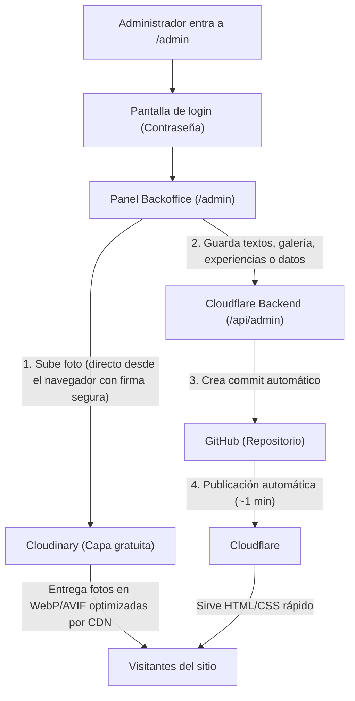

# Guía del Panel Administrativo (Backoffice) · Río Téllez

El panel administrativo (`/admin`) permite gestionar la landing page sin necesidad de tocar código, sin cuentas de GitHub para los editores y **sin necesidad de tarjeta de crédito**.

---

## 1. ¿Cómo funciona la arquitectura?

---

## 2. Variables para configurar en Cloudflare

En tu panel de Cloudflare:
Ve a tu proyecto **rio-tellez-website** → **Settings** → **Variables and secrets**.

Añade las siguientes variables:

| Nombre de la variable | Valor | ¿Es secreta? |
|---|---|---|
| `ADMIN_PASSWORD` | La contraseña que tú elijas para entrar al panel (ej. `RioTellez2026*`) | **Encrypt / Secret** |
| `CLOUDINARY_CLOUD_NAME` | `enjl5syu` | No |
| `PUBLIC_CLOUDINARY_CLOUD_NAME` | `enjl5syu` | No |
| `CLOUDINARY_API_KEY` | Tu API Key de Cloudinary | No |
| `CLOUDINARY_API_SECRET` | Tu API Secret de Cloudinary | **Encrypt / Secret** |
| `GITHUB_REPO` | `ovelasqueza/rio-tellez-website` | No |
| `GITHUB_BRANCH` | `main` | No |
| `GITHUB_TOKEN` | Tu token de GitHub que empieza por `github_pat_...` | **Encrypt / Secret** |

*(Nota: en **Settings** → **Builds** → **Build environment variables**, también puedes añadir `PUBLIC_CLOUDINARY_CLOUD_NAME = enjl5syu`).*

---

## 3. ¿Cómo entrar al panel?

1. Una vez guardadas las variables y completado el despliegue en Cloudflare:
2. Entra a: `https://tu-sitio.workers.dev/admin` (o tu dominio `/admin`).
3. Verás la pantalla de inicio de sesión pidiéndote la contraseña.
4. Escribe la contraseña que definiste en `ADMIN_PASSWORD`.
5. ¡Listo! Ya estás dentro del panel. La sesión queda guardada de forma segura por 30 días en tu navegador.
